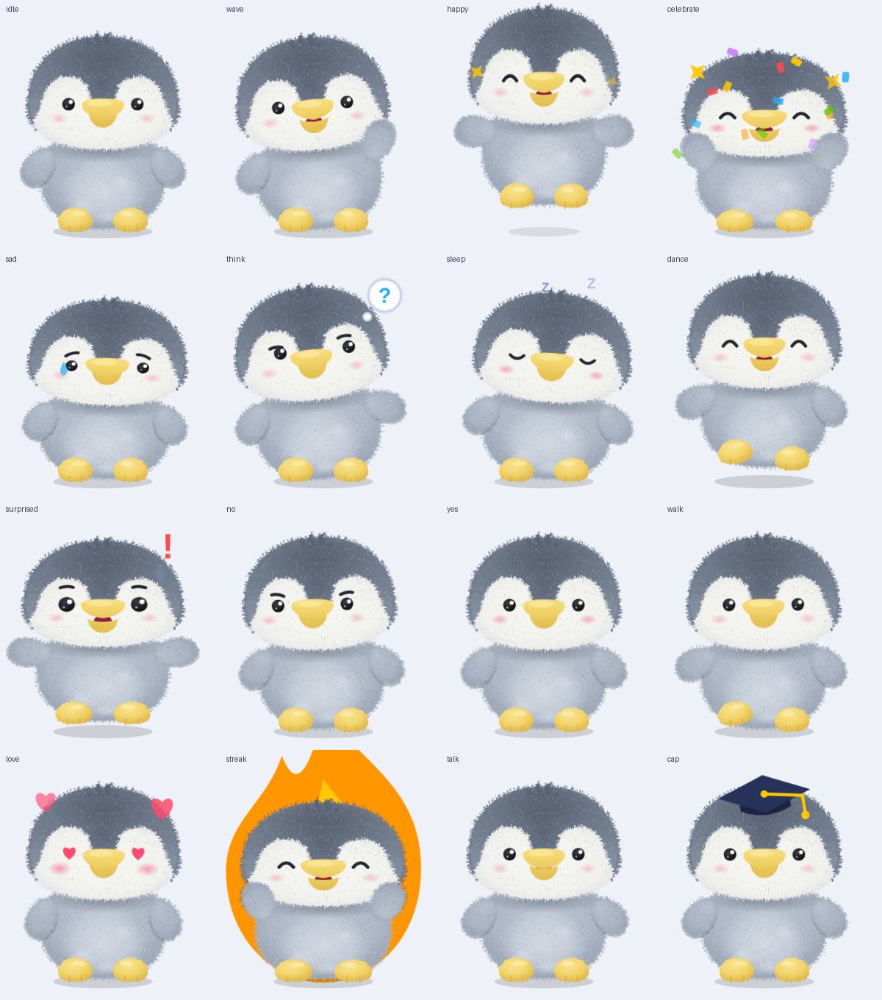

# 🐧 Penguin Mascot

Linh vật chim cánh cụt **BipBip** cho app học tập, bản **Bông** (giống thú bông lông xám). Vẽ hoàn toàn bằng SVG, animation bằng CSS, đóng gói thành Web Component `<penguin-mascot>` nên dùng được trong HTML thuần, React, Vue, Svelte, Angular… mà không cần thư viện nào.




## Xem thử

Mở `examples/web/index.html` bằng trình duyệt (hoặc `npx serve .`). Trang demo có nút cho từng animation, tuỳ chọn đội mũ tốt nghiệp, chỉnh kích thước và một câu hỏi mẫu để thấy linh vật phản ứng khi trả lời đúng/sai.

## Các animation (15)

| Tên | Kiểu | Khi nào dùng |
|---|---|---|
| `idle` | lặp | Mặc định: thở nhẹ, chớp mắt |
| `think` | lặp | Đang chờ người học trả lời (có bong bóng “?”) |
| `sleep` | lặp | Lâu không học, chế độ chờ (Zzz) |
| `dance` | lặp | Màn hình vui vẻ, phần thưởng |
| `walk` | lặp | Chuyển màn, loading |
| `talk` | lặp | Đang đọc hướng dẫn / phát âm |
| `wave` | một lần | Chào mừng, mở app |
| `happy` | một lần | Trả lời đúng |
| `celebrate` | một lần | Hoàn thành bài học (pháo giấy) |
| `sad` | một lần | Trả lời sai (rơi nước mắt) |
| `surprised` | một lần | Điều bất ngờ, mở khoá |
| `no` | một lần | Lắc đầu: “chưa đúng” |
| `yes` | một lần | Gật đầu: “đúng rồi” |
| `love` | một lần | Cảm ơn, thả tim |
| `streak` | một lần | Giữ chuỗi ngày học (ngọn lửa) |

Animation **một lần** chạy xong sẽ tự quay về animation **lặp** gần nhất (mặc định `idle`).

## Cách dùng

```html
<script src="penguin.js"></script>

<penguin-mascot id="pg" variant="plush" size="200"></penguin-mascot>

<script>
  const pg = document.getElementById('pg');
  pg.play('happy');                    // chạy animation
  await pg.play('sad');                // play() trả về Promise, resolve khi xong
  pg.setAttribute('state', 'think');   // hoặc đổi qua thuộc tính
  pg.state = 'sleep';                  // hoặc qua property
</script>
```

### Thuộc tính

| Thuộc tính | Ví dụ | Ý nghĩa |
|---|---|---|
| `variant` | `variant="plush"` | Phiên bản hình, hiện chỉ có `plush` (mặc định; tên lạ cũng dùng `plush`) |
| `state` | `state="dance"` | Animation đang chạy |
| `size` | `size="160"` hoặc `size="10rem"` | Chiều rộng (mặc định 200px) |
| `accessory` | `accessory="cap"` | Đội mũ tốt nghiệp |

BipBip luôn đeo vòng cổ da nâu với thẻ tên khắc chữ "BipBip" (`pg-collar`, `pg-tag`); thẻ lắc nhẹ theo nhịp ở vài trạng thái.

### Sự kiện

- `statechange`: mỗi khi đổi animation, `event.detail.state`
- `animationdone`: khi animation một lần kết thúc

```js
pg.addEventListener('animationdone', (e) => console.log('xong', e.detail.state));
```

### React

```jsx
import './penguin.js';

export function Mascot({ state }) {
  return <penguin-mascot state={state} size="180" />;
}
```

## Tuỳ biến

- Hình và màu bản bông nằm ở cuối file `packages/web/penguin.js`.
- Muốn thêm phiên bản hình khác: gọi `PenguinMascot.registerVariant('ten', { defs, character, css, fx })`, xem bản bông ở cuối `packages/web/penguin.js` làm mẫu.
- Tốc độ animation một lần nằm trong `ONE_SHOT` (đơn vị ms), phải khớp với thời lượng trong CSS và với `spec/mascot.json`.
- Muốn thêm animation mới: thêm tên vào `LOOPING` hoặc `ONE_SHOT` và vào `spec/mascot.json`, rồi thêm các rule `.pg[data-state="ten-moi"] ...` và `@keyframes` trong mảng `CSS`.
- Người dùng bật “giảm chuyển động” (prefers-reduced-motion) sẽ thấy animation tắt bớt.

## File

- `packages/web/penguin.js`: Web Component (SVG + CSS + API), không phụ thuộc gì. `penguin.js` và `penguin-plush.svg` ở thư mục gốc là bản chép (`npm run sync:root`) để link cũ không hỏng
- `packages/web/penguin-plush.svg`: hình tĩnh, dùng làm icon, ảnh đại diện
- `spec/mascot.json`: danh sách trạng thái, thời lượng, kiểu lặp (nguồn sự thật; `penguin.js` phải khớp, `npm test` kiểm tra)
- `examples/web/index.html`: trang demo (đủ 15 trạng thái)
- `tools/export-frames.mjs`: xuất sprite sheet cho app native (xem mục trên)

## Dùng cho app di động / Flutter (sprite sheet)

Bản bông dùng filter SVG (`feTurbulence`) và CSS animation nên không nhúng thẳng được vào Flutter, Swift hay Kotlin. Thay vào đó, công cụ `tools/export-frames.mjs` **tua animation CSS tới từng khung rồi chụp qua Chrome**, xuất mỗi animation thành một sprite sheet WebP trong suốt cộng một `manifest.json`. Mọi nền tảng đều đọc được, chuyển động giữ nguyên như bản web.

```bash
npm run export:frames -- --variant plush --out export/plush
npm run export:frames -- --states idle,wave,happy,sad --fps 15 --out ../app/assets/mascot
```

Cần Chrome và Node 22+, không cần cài thư viện. Tuỳ chọn: `--variant` (plush), `--states` (mặc định tất cả 15), `--fps` (15), `--size` (256x320, kích thước một khung), `--cols` (8, số khung mỗi hàng), `--quality` (0.8), `--chrome` (đường dẫn Chrome nếu không ở chỗ mặc định).

Kết quả:

```text
export/plush/
├── manifest.json      # variant, frameWidth/Height, fps, columns, states{ file, frames, durationMs, loop }
├── idle.webp          # sprite sheet: khung xếp từ trái sang phải, từ trên xuống dưới
├── wave.webp
└── ...
```

- Animation **lặp** (`loop: true`) được cân lại để khung cuối nối khớp khung đầu; chạy vòng tròn là mượt.
- Animation **một lần** chạy hết `durationMs` rồi nên quay về `idle` (giống component web).
- Mỗi khung `frameWidth × frameHeight` ở vị trí `(i % columns, i ~/ columns)`. Phát bằng cách đổi chỉ số khung theo `fps`.
- Thêm animation mới: thêm vào `penguin.js` như hướng dẫn ở mục Tuỳ biến, rồi khai trong `spec/mascot.json` và chạy `npm run codegen`; `export-frames` đọc thời lượng từ spec.

Ví dụ Flutter nằm trong repo PRM393_G6_FE (`Mascot` trong `lib/widgets/`). Nếu cần hình vector có thể chỉnh được trong editor, có thể nhập `penguin.svg` vào **Rive** (các bộ phận đã tách lớp sẵn) rồi dựng lại animation theo bảng ở trên.

## Dựng linh vật trong Rive

`npm run export:layers` tách từng bộ phận của bản bông ra PNG 3x trong suốt (`art/plush/`, lông đã nướng sẵn) cùng `parts.json`, bảng vị trí `parts.md` và hiệu ứng SVG (`art/plush/fx/`); thêm `-- --verify` để ghép lại và so với hình gốc. Hợp đồng rig và hướng dẫn dựng `bipbip.riv` ở [`rive/README.md`](rive/README.md).

## Cấu trúc monorepo

```text
spec/mascot.json     nguồn sự thật: trạng thái, thời lượng, loop, input Rive
packages/web         web component <penguin-mascot> (@prm393/penguin-mascot, chưa publish)
packages/web-rive    renderer="rive" cho web component (có đường lùi về SVG)
packages/react       component <PenguinMascot> (Rive, lùi về web component)
packages/flutter     states.dart sinh từ spec (widget Flutter làm ở giai đoạn 5)
art/plush            bộ phận PNG + fx SVG để nhập vào Rive (export-layers)
rive/README.md       hợp đồng rig và hướng dẫn dựng bipbip.riv
tools/               codegen, export-frames, export-layers, ...
examples/web         trang demo (SVG)
examples/web-rive    demo renderer="rive" (Vite)
examples/react       demo React (Vite)
docs/PLAN.md         kế hoạch nhiều nền tảng
```

Lệnh ở thư mục gốc: `npm test`, `npm run codegen` (sinh `states.ts`/`states.dart` từ spec), `npm run sync:root`.

## Kiểm thử

```bash
npm test
```

Dùng `node --test`, cần Node 22+ và Chrome (đặt biến `CHROME` nếu không ở chỗ mặc định). Test kiểm tra spec hợp lệ, file sinh ra khớp spec, bản chép ở gốc giống `packages/web`, trạng thái trong `penguin.js` khớp spec, và thuộc tính `variant` viết sẵn trong HTML được đọc đúng.
