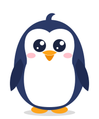
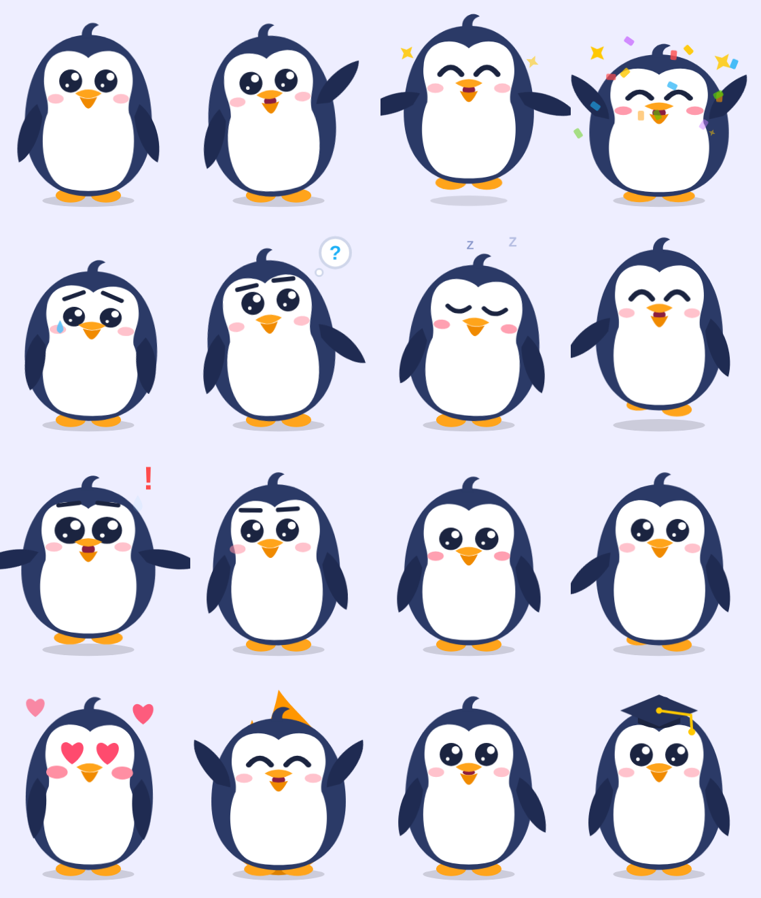

# 🐧 Penguin Mascot

Linh vật chim cánh cụt cho app học tập, có 2 phiên bản: **Bông** (giống thú bông lông xám) và **Cổ điển** (phẳng, kiểu Duolingo). Vẽ hoàn toàn bằng SVG, animation bằng CSS, đóng gói thành Web Component `<penguin-mascot>` nên dùng được trong HTML thuần, React, Vue, Svelte, Angular… mà không cần thư viện nào.

| Bông (`variant="plush"`) | Cổ điển (mặc định) |
|---|---|
|  |  |




## Xem thử

Mở `index.html` bằng trình duyệt (hoặc `npx serve .`). Trang demo có nút chọn phiên bản, nút cho từng animation, tuỳ chọn đội mũ tốt nghiệp, chỉnh kích thước và một câu hỏi mẫu để thấy linh vật phản ứng khi trả lời đúng/sai.

## Các animation (15)

| Tên | Kiểu | Khi nào dùng |
|---|---|---|
| `idle` | lặp | Mặc định: thở nhẹ, chớp mắt |
| `think` | lặp | Đang chờ người học trả lời (có bong bóng “?”) |
| `sleep` | lặp | Lâu không học, chế độ chờ (Zzz) |
| `dance` | lặp | Màn hình vui vẻ, phần thưởng |
| `walk` | lặp | Chuyển màn, loading |
| `talk` | lặp | Đang đọc hướng dẫn / phát âm |
| `wave` | một lần | Chào mừng, mở app |
| `happy` | một lần | Trả lời đúng |
| `celebrate` | một lần | Hoàn thành bài học (pháo giấy) |
| `sad` | một lần | Trả lời sai (rơi nước mắt) |
| `surprised` | một lần | Điều bất ngờ, mở khoá |
| `no` | một lần | Lắc đầu: “chưa đúng” |
| `yes` | một lần | Gật đầu: “đúng rồi” |
| `love` | một lần | Cảm ơn, thả tim |
| `streak` | một lần | Giữ chuỗi ngày học (ngọn lửa) |

Animation **một lần** chạy xong sẽ tự quay về animation **lặp** gần nhất (mặc định `idle`).

## Cách dùng

```html
<script src="penguin.js"></script>

<penguin-mascot id="pg" variant="plush" size="200"></penguin-mascot>

<script>
  const pg = document.getElementById('pg');
  pg.play('happy');                    // chạy animation
  await pg.play('sad');                // play() trả về Promise, resolve khi xong
  pg.setAttribute('state', 'think');   // hoặc đổi qua thuộc tính
  pg.state = 'sleep';                  // hoặc qua property
</script>
```

### Thuộc tính

| Thuộc tính | Ví dụ | Ý nghĩa |
|---|---|---|
| `variant` | `variant="plush"` | Phiên bản hình: `plush` (bông) hoặc `classic` (mặc định) |
| `state` | `state="dance"` | Animation đang chạy |
| `size` | `size="160"` hoặc `size="10rem"` | Chiều rộng (mặc định 200px) |
| `accessory` | `accessory="cap"` | Đội mũ tốt nghiệp |

### Sự kiện

- `statechange`: mỗi khi đổi animation, `event.detail.state`
- `animationdone`: khi animation một lần kết thúc

```js
pg.addEventListener('animationdone', (e) => console.log('xong', e.detail.state));
```

### React

```jsx
import './penguin.js';

export function Mascot({ state }) {
  return <penguin-mascot state={state} size="180" />;
}
```

## Tuỳ biến

- Màu bản cổ điển nằm trong object `COLORS` đầu file `penguin.js`; bản bông nằm ở cuối file.
- Muốn thêm phiên bản hình khác: gọi `PenguinMascot.registerVariant('ten', { defs, character, css, fx })`, xem bản bông ở cuối `penguin.js` làm mẫu.
- Tốc độ animation một lần nằm trong `ONE_SHOT` (đơn vị ms), phải khớp với thời lượng trong CSS.
- Muốn thêm animation mới: thêm tên vào `LOOPING` hoặc `ONE_SHOT`, rồi thêm các rule `.pg[data-state="ten-moi"] ...` và `@keyframes` trong mảng `CSS`.
- Người dùng bật “giảm chuyển động” (prefers-reduced-motion) sẽ thấy animation tắt bớt.

## File

- `penguin.js`: Web Component (SVG + CSS + API), ~28 KB, không phụ thuộc gì
- `penguin-plush.svg`, `penguin.svg`: hình tĩnh của 2 phiên bản, dùng làm icon, ảnh đại diện
- `index.html`: trang demo

## Dùng cho app di động?

Bản này chạy trên web (kể cả WebView). Nếu app viết bằng Flutter, React Native, Swift hay Kotlin, có thể chuyển sang **Rive** hoặc **Lottie**: nhập `penguin.svg` vào Rive editor (các bộ phận đã tách lớp sẵn: thân, bụng, mắt, mỏ, cánh, chân) rồi dựng lại các animation theo bảng ở trên.
