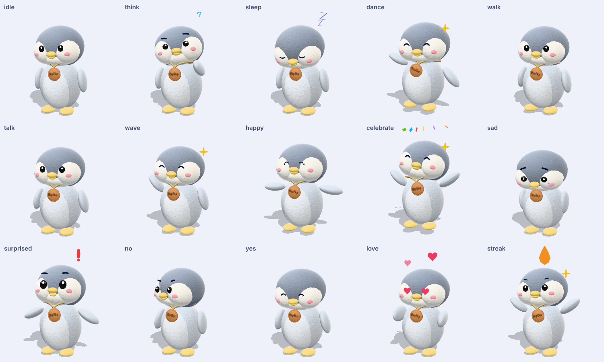

# BipBip 3D (glTF)

File sinh ra bởi `npm run build:3d` (`tools/model3d/`). Không sửa tay; sửa generator rồi dựng lại.
`npm run build:3d:check` và `test/model3d.test.mjs` báo lỗi nếu file lệch generator hoặc spec.

| File | Dùng khi | Tam giác | Dung lượng |
| --- | --- | --- | --- |
| `bipbip.glb` | gần, nhân vật chính (LOD0) | 7.116 | ~1,1 MB |
| `bipbip_lod1.glb` | cỡ vừa | 2.634 | ~0,9 MB |
| `bipbip_lod2.glb` | xa, danh sách dài, 1 texture | 1.446 | ~0,6 MB |
| `bipbip.manifest.json` | số liệu ngân sách và số khóa mỗi clip | | |

- 12 xương, 1 skin, 11 draw call lúc nghỉ, đơn vị mét, Y lên, mặt về +Z, cao ~1 m.
- 15 clip tên đúng như `spec/mascot.json` (idle, think, sleep, dance, walk, talk, wave, happy, celebrate, sad,
  surprised, no, yes, love, streak), cùng thời lượng, lấy mẫu 30 FPS. Clip lặp có khung đầu bằng khung cuối.
- Biểu cảm và hiệu ứng là các node `fx_*` (scale 0,001 lúc nghỉ, clip bật lên). Runtime nên đặt `visible = false`
  khi scale gần 0 để khỏi tốn draw call. `fx_cap` (mũ) không bị clip nào chạm: runtime tự bật/tắt (`cap`).
- `eye_l`, `eye_r` chỉ bị clip chạm vào scale (chớp mắt); runtime tự xoay chúng để mắt nhìn theo (`lookX`, `lookY`).
- Thông tin máy đọc được nằm ở `asset.extras.bipbip` trong chính file GLB (trạng thái, xương, node bật/tắt).
- Lông: normal map + albedo nhiễu lông + `KHR_materials_sheen`; thẻ BipBip và dây là texture riêng.
  Engine không hỗ trợ sheen (ví dụ Godot) vẫn đẹp nhờ normal map. Hiệu ứng `fx_*` dùng `KHR_materials_unlit` + màu đỉnh.
- Chưa có tangent trong file: engine tự tính (three.js, Godot, Unity đều làm được); validator chỉ cảnh báo.

